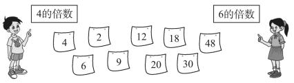

# Mathematics (Grade 5)

**ID**: ed178180
**难度**: medium_hard
**题型**: short_answer

## 题目
找一个数的倍数
看谁找得快。

哪些数既是4的倍数，又是6的倍数？

## 解答

**答案**: 12, 48

1. Step1:找出给定数字中4的倍数，得到4，12，20，48
2. Step2:找出给定数字中6的倍数，得到6，12，18，30，48
3. Step3:找出既在4的倍数中又在6的倍数中的数，得到12和48
4. Step4:将12和48整理为列表['12', '48']

## 知识点

**知识点**:
  - 因数和倍数的意义

---
