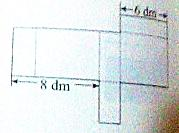

# Mathematics (Grade 5)

**ID**: f18e9245
**难度**: medium_hard
**题型**: short_answer

## 题目
一个长方形包装箱，展开后如图，这个长方体包装箱的表面积是多少平方分米？

## 解答

**答案**: 120

1. Step1:根据图形可知长方体的长是6分米，宽是6分米
2. Step2:计算长方体的高，由8 - 6 = 2分米可得高为2分米
3. Step3:明确长方体表面积公式为s=(ab + bh + ah)×2，其中a为长，b为宽，h为高
4. Step4:代入长a = 6分米，宽b = 6分米，高h = 2分米到表面积公式，得到(6×6 + 6×2 + 6×2)×2
5. Step5:先计算括号内的值，6×6 = 36，6×2 = 12，6×2 = 12，即(36 + 12 + 12)×2
6. Step6:计算括号内相加的结果，36 + 12 + 12 = 60，得到60×2
7. Step7:计算60×2 = 120，得出长方体包装箱的表面积是120平方分米

## 知识点

**知识点**:
  - 长方体和正方体的表面积

---
