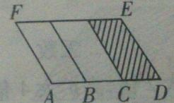

# Mathematics (Grade 5)

**ID**: f2818fa8
**难度**: medium_hard
**题型**: short_answer

## 题目
如图，AB=BC=CD，大平行四边形ADEF的面积是
 $72cm^{2}$
  ，你能求出图中小平行四边形(阴影部分)的面积吗？

## 解答

**答案**: 24(cm^{2})

1. Step1:观察图形可知大平行四边形ADEF的底AD被平均分成了AB、BC、CD三段，且AB=BC=CD，即大平行四边形的底被平均分成了3份
2. Step2:因为大平行四边形ADEF与小平行四边形（阴影部分）高相等，根据平行四边形面积=底×高，在高不变的情况下，底平均分成3份，则每份对应的面积是原来大平行四边形面积的1/3
3. Step3:已知大平行四边形ADEF的面积是72cm²，所以小平行四边形（阴影部分）的面积为72×1/3 = 24(cm²)

## 知识点

**知识点**:
  - --

---
