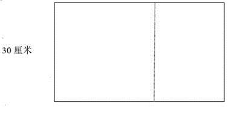

# Mathematics (Grade 5)

**ID**: f38ff4f8
**难度**: medium_hard
**题型**: short_answer

## 题目
琪琪有一张宽30厘米的长方形彩纸，她从这张彩纸上裁下一个最大的正方形，剩下的彩纸的面积是360平方厘米。原来彩纸的面积是多少平方厘米？ 

## 解答

**答案**: 1260平方厘米

1. Step1:因为裁下的最大正方形的边长等于原来长方形的宽，所以该正方形边长为30厘米
2. Step2:剩下彩纸是一个长方形，它的宽是30厘米，已知其面积是360平方厘米，根据长方形面积公式，可推出剩下彩纸长方形的长为360÷30 = 12厘米
3. Step3:原来长方形彩纸的长等于剩下彩纸长方形的长加上裁下正方形的边长，即12 + 30 = 42厘米
4. Step4:根据长方形面积公式，原来彩纸的面积为42×30 = 1260平方厘米

## 知识点

**知识点**:
  - 小学数学;数与代数;应用题;面积、体积相关应用题;长方形、正方形相关的应用题

---
