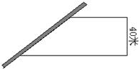

# Mathematics (Grade 5)

**ID**: fb15a643
**难度**: medium_hard
**题型**: short_answer

## 题目
用总长320米篱笆靠墙围城一个梯形果园，如果每棵果树占地10平方米，这个果园共有果树多少棵？

## 解答

**答案**: 560

1. Step1:根据篱笆总长320米和靠墙以及梯形高40米，得出梯形上底与下底的和为320 - 40 = 280米
2. Step2:利用梯形面积公式S=(a + b)×h÷2（这里a + b为上底与下底的和280米，h为高40米），计算出果园面积为280×40÷2 = 5600平方米
3. Step3:用果园面积5600平方米除以每棵果树占地10平方米，得出果树棵数为5600÷10 = 560棵

## 知识点

**知识点**:
  - 梯形的面积．

---
