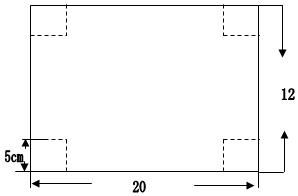

# Mathematics (Grade 5)

**ID**: fdc73f8f
**难度**: medium_hard
**题型**: short_answer

## 题目
如图是一块长方形纸板，剪掉四个角上边长相等的正方形，做一个没有盖子的纸盒，求这个纸盒的表面积和容积．（单位：厘米）

## 解答

**答案**: 140, 100

1. Step1:计算纸盒的表面积，长方形纸板面积为20×12 = 240平方厘米，四个角上正方形的面积为5×5×4 = 100平方厘米，所以纸盒表面积为240 - 100 = 140平方厘米
2. Step2:计算纸盒的长，由20 - 5×2 = 10厘米
3. Step3:计算纸盒的宽，由12 - 5×2 = 2厘米
4. Step4:计算纸盒的容积，根据长方体容积公式，容积为10×2×5 = 100立方厘米

## 知识点

**知识点**:
  - 长方体、正方体表面积与体积计算的应用

---
