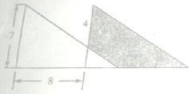

# Mathematics (Grade 5)

**ID**: ffb4adc0
**难度**: medium_hard
**题型**: short_answer

## 题目
将两个完全一样的直角三角形重叠，如图．求阴影部分的面积．（图中单位：cm）

## 解答

**答案**: 40

1. Step1:分析得出阴影部分的面积 = 大三角形的面积 - 右边小三角形的面积 = 左边梯形的面积
2. Step2:计算梯形的上底，由7 - 4 = 3厘米
3. Step3:明确梯形的下底是7厘米，高是8厘米
4. Step4:根据梯形面积公式S=(a + b)×h÷2（其中a为上底，b为下底，h为高），代入数值计算，即(3 + 7)×8÷2
5. Step5:先计算括号内3 + 7 = 10
6. Step6:再计算10×8 = 80
7. Step7:最后计算80÷2 = 40平方厘米，得出阴影部分面积为40平方厘米

## 知识点

**知识点**:
  - 组合图形的面积

---
