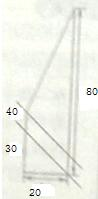

# Mathematics (Grade 5)

**ID**: fff5c972
**难度**: medium_hard
**题型**: short_answer

## 题目
有一条引水渠穿过了一块麦地（如图），这块地原来的总面积是这段引水渠占地面积的几倍？

## 解答

**答案**: 1.375

1. Step1:根据梯形面积公式S=(a + b)×h÷2（其中a为上底30，b为下底80，h为高20），计算这块地的总面积，即(30 + 80)×20÷2 = 110×20÷2 = 1100
2. Step2:根据平行四边形面积公式S = a×h（其中a为底40，h为高20），计算引水渠的占地面积，即40×20 = 800
3. Step3:用这块地的总面积除以引水渠的占地面积，即1100÷800 = 1.375

## 知识点

**知识点**:
  - 梯形的面积;平行四边形的面积

---
