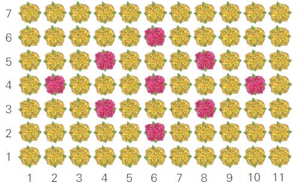

# Mathematics (Grade 5)

**ID**: 095efb74
**难度**: medium
**题型**: multiple_choice

## 题目
判断下列红花的数对正确的是（ ） 

$\begin{description}
\item A．(3.5)\item B．(2，1)\item C．(4，4)\item D．(6，2)
\end{description}$

## 解答

**答案**: D

1. Step1:明确题目要求是判断哪个选项中的数对能正确表示图中红花的位置
2. Step2:分析选项A，(3,5)对应的位置没有红花
3. Step3:分析选项B，(2,1)对应的位置没有红花
4. Step4:分析选项C，(4,4)对应的位置没有红花
5. Step5:分析选项D，(6,2)对应的位置有红花，符合要求，所以答案是D

## 知识点

**知识点**:
  - 

---
