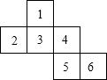

# Mathematics (Grade 5)

**ID**: 0de6eb8b
**难度**: medium
**题型**: multiple_choice

## 题目
如图是一个正方体的展开图，(  )号与6号面相对．

A．1
B．2
C．3
D．4

## 解答

**答案**: C

1. Step1:明确这是一个正方体展开图找相对面的问题
2. Step2:根据正方体展开图的特征，想象将其折叠成正方体
3. Step3:分析得出2号、3号、4号、6号组成正方体的四面，1号组成正方体的上面，5号组成正方体的下面
4. Step4:确定1号与5号相对，2号与4号相对，3号与6号相对
5. Step5:得出与6号面相对的是3号面，对应选项C

## 知识点

**知识点**:
  - 正方体的展开图．

---
