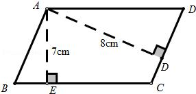

# Mathematics (Grade 5)

**ID**: 1cbcdccd
**难度**: medium
**题型**: multiple_choice

## 题目
如图，▱ABCD的周长60cm，则它的面积为（    ）cm$^{2}$．

A．98
B．112
C．128
D．98或112

## 解答

**答案**: B

1. Step1:设BC=x cm，CD=y cm，因为平行四边形对边相等，所以周长为2(x + y)=60，可得x + y=30。
2. Step2:根据平行四边形面积公式，以BC为底时面积S = 7x，以CD为底时面积S = 8y，所以7x = 8y。
3. Step3:联立方程x + y=30和7x = 8y，由x + y=30可得x = 30 - y，将其代入7x = 8y中，得到7(30 - y)=8y。
4. Step4:展开7(30 - y)=8y得210 - 7y = 8y，移项可得210 = 8y + 7y，即15y = 210，解得y = 14。
5. Step5:把y = 14代入x + y=30，可得x = 30 - 14 = 16。
6. Step6:求平行四边形面积，以BC为底，BC = 16cm，高为7cm，根据面积公式S = 7×16 = 112cm²。

## 知识点

**知识点**:
  - 小学数学;图形与几何;平面图形;平行四边形;平行四边形的面积

---
