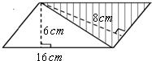

# Mathematics (Grade 5)

**ID**: 2334ab37
**难度**: medium
**题型**: multiple_choice

## 题目
如图阴影部分的面积计算正确的是(  )
A．16×6
B．8×16÷2
C．16×6÷2

## 解答

**答案**: C

1. Step1:观察图形可知阴影部分是一个三角形
2. Step2:根据三角形面积公式S = 底×高÷2，此阴影三角形的底是16cm，高是6cm
3. Step3:将底16cm和高6cm代入三角形面积公式，可得面积为16×6÷2，所以答案选C

## 知识点

**知识点**:
  - 三角形的周长和面积;平行四边形的面积．

---
