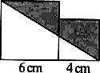

# Mathematics (Grade 5)

**ID**: 253e5a69
**难度**: medium
**题型**: multiple_choice

## 题目
如图两个正方形中阴影部分的面积是(    )．

$\begin{description}
\item A．30平方厘米\item B．22平方厘米\item C．50平方厘米
\end{description}$

## 解答

**答案**: B

1. Step1:先计算两个正方形的面积，大正方形边长为6cm，根据正方形面积公式S=a²（a为边长），其面积为6×6 = 36平方厘米，小正方形边长为4cm，面积为4×4 = 16平方厘米，所以两个正方形总面积为36 + 16 = 52平方厘米。
2. Step2:再计算空白三角形的面积，三角形底为6 + 4 = 10厘米，高为6厘米，根据三角形面积公式S=ah÷2（a为底，h为高），其面积为10×6÷2 = 30平方厘米。
3. Step3:最后用两个正方形总面积减去空白三角形面积得到阴影部分面积，即52 - 30 = 22平方厘米，答案选B。

## 知识点

**知识点**:
  - 小学数学;图形与几何;平面图形;阴影部分的周长和面积

---
