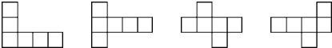

# Mathematics (Grade 5)

**ID**: 296f49b0
**难度**: medium
**题型**: multiple_choice

## 题目
下列图形中，能折成正方体的图形有（  ）个．

A．1
B．2
C．3
D．4

## 解答

**答案**: C

1. Step1:明确正方体展开图的类型有1-4-1型，2-3-1型，2-2-2型，3-3型
2. Step2:观察第一个图形，判断其不属于正方体展开图的上述类型
3. Step3:观察第二个图形，判断其属于正方体展开图类型，能折成正方体
4. Step4:观察第三个图形，判断其属于正方体展开图类型，能折成正方体
5. Step5:观察第四个图形，判断其属于正方体展开图类型，能折成正方体
6. Step6:统计能折成正方体的图形个数为3个

## 知识点

**知识点**:
  - 正方体的展开图．

---
