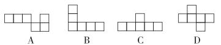

# Mathematics (Grade 5)

**ID**: 34c9064c
**难度**: medium
**题型**: multiple_choice

## 题目
下列展开图中，（）可以折成一个正方体。

## 解答

**答案**: D

1. Step1:明确题目要求是找出能折成正方体的展开图
2. Step2:知道正方体展开图有11种情况
3. Step3:逐一分析选项，判断哪个选项的图形属于正方体展开图
4. Step4:得出D选项的图形可以折成一个正方体

## 知识点

**知识点**:
  - 长、正方体的展开与折叠

---
