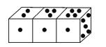

# Mathematics (Grade 5)

**ID**: 3b1768a7
**难度**: medium
**题型**: multiple_choice

## 题目
有三个相同的骰子摆放如下图，底面点数之和最小是(  )

$\begin{description}
\item A．10\item B．11\item C．12\item D．无法判断
\end{description}$

## 解答

**答案**: C

1. Step1:观察骰子可知，与1点相邻的面有点数2、3、4、5，所以1点的对面是6点。
2. Step2:因为与5点相邻的面有点数1、3、6，所以5点的对面是2点。
3. Step3:那么3点的对面就是4点。
4. Step4:要使底面点数之和最小，就应让已知面点数尽量大，从图中可知上面的点数分别是1、5、3，所以底面点数分别是6、2、4。
5. Step5:计算底面点数之和为6 + 2 + 4 = 12。
6. Step6:得出底面点数之和最小是12，答案选C。

## 知识点

**知识点**:
  - 小学数学;图形与几何;立体图形;长方体和正方体;正方体的特征

---
