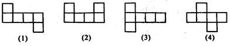

# Mathematics (Grade 5)

**ID**: 3b474698
**难度**: medium
**题型**: multiple_choice

## 题目
如下图,哪些图形可以折成一个棱柱?(   )

$\begin{description}
\item A．(1)(2)(3)\item B．(2)(3)(4)\item C．(1)(3)(4)\item D．(1)(2)(4)
\end{description}$

## 解答

**答案**: C

1. Step1:分析(1)图形，它是一个“一四一”型的展开图，符合棱柱展开图的特征，可以折成棱柱。
2. Step2:分析(2)图形，其结构不符合棱柱展开图的特征，不能折成棱柱。
3. Step3:分析(3)图形，它也是“一四一”型展开图，能够折成棱柱。
4. Step4:分析(4)图形，同样是“一四一”型展开图，可折成棱柱。
5. Step5:综合以上分析，(1)(3)(4)图形可以折成棱柱，所以答案选C。

## 知识点

**知识点**:
  - 

---
