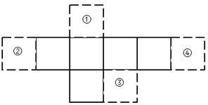

# Mathematics (Grade 5)

**ID**: 3d2f5e2e
**难度**: medium
**题型**: multiple_choice

## 题目
正方体展开有6个面，下图中给出了5个面，那么第6个面应该是①②③④中的（        ）．

$\begin{description}
\item A．①\item B．②\item C．③\item D．④
\end{description}$

## 解答

**答案**: A

1. Step1:明确正方体展开图有 6 个面，题目已给出 5 个面，需找出第 6 个面。
2. Step2:根据正方体展开图的特征，分析①②③④四个选项与已给出 5 个面的关系。
3. Step3:判断得出①是第 6 个面，对应答案 A。

## 知识点

**知识点**:
  - 小学数学;图形与几何;立体图形;长方体和正方体;正方体的展开图

---
