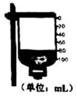

# Mathematics (Grade 5)

**ID**: 47103d7f
**难度**: medium
**题型**: multiple_choice

## 题目
一个输液瓶内有$100mL$药液，输液时要将输液瓶倒置。如果每分钟输液$2.5mL$，输液12分钟后瓶内所剩药液情况如图，这个输液瓶的容积是（  ）$mL$。

A．100
B．120
C．130
D．150

## 解答

**答案**: D

1. Step1:先计算12分钟输液的量，根据每分钟输液2.5mL，可得12分钟输液量为2.5×12 = 30mL
2. Step2:已知瓶内原有100mL药液，那么12分钟后瓶内剩余药液为100 - 30 = 70mL
3. Step3:由图可知，此时空瓶部分的容积是80mL
4. Step4:计算输液瓶的容积，即剩余药液量与空瓶部分容积之和，70 + 80 = 150mL

## 知识点

**知识点**:
  - 小学数学;数与代数;应用题;面积、体积相关应用题

---
