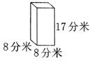

# Mathematics (Grade 5)

**ID**: 4b1f9e73
**难度**: medium
**题型**: multiple_choice

## 题目
计算下图中长方体的表面积，算式错误的是（  ）。

$\begin{description}
\item A．8×8×17\item B．8×17×4＋8×8×2\item C．（8×17＋8×17＋8×8）×2
\end{description}$

## 解答

**答案**: A

1. Step1:明确长方体表面积公式为(长×宽 + 长×高 + 宽×高)×2，此长方体长和宽都是8分米，高是17分米。
2. Step2:分析选项A，8×8×17不符合长方体表面积公式，它表示的意义与长方体表面积无关。
3. Step3:分析选项B，8×17×4 + 8×8×2，其中8×17×4是4个相同面（长为17分米、宽为8分米）的面积和，8×8×2是2个相同面（边长为8分米的正方形）的面积和，符合长方体表面积的计算。
4. Step4:分析选项C，(8×17 + 8×17 + 8×8)×2完全符合长方体表面积公式(长×宽 + 长×高 + 宽×高)×2。
5. Step5:综上，算式错误的是A。

## 知识点

**知识点**:
  - 小学数学;图形与几何

---
