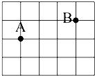

# Mathematics (Grade 5)

**ID**: 4d150ff9
**难度**: medium
**题型**: multiple_choice

## 题目
如图中，如果点A的位置表示为(2，3)，则点B的位置可以表示为(  )

A．(4，3)
B．(5，4)
C．(3，4)
D．(4，5)

## 解答

**答案**: B

1. Step1:根据解析2可知，数对中第一个数字表示列，第二个数字表示行
2. Step2:已知点A的位置表示为(2，3)，说明点A在第2列，第3行
3. Step3:观察图形，确定点B所在的列数为5，行数为4
4. Step4:按照数对表示位置的方法，点B的位置用数对表示为(5，4)，所以答案选B

## 知识点

**知识点**:
  - 数对与位置．

---
