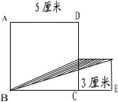

# Mathematics (Grade 5)

**ID**: 5d05df7c
**难度**: medium
**题型**: multiple_choice

## 题目
如图，阴影部分的面积是(  )平方厘米．
A．7.5
B．12.5
C．4.5

## 解答

**答案**: C

1. Step1:根据解析2可知，阴影部分是三角形，其底和高都等于小正方形的边长，小正方形边长为3厘米
2. Step2:由三角形面积公式S = 底×高÷2，这里底为3厘米，高为3厘米
3. Step3:将底和高的值代入公式计算，即3×3÷2 = 4.5平方厘米
4. Step4:根据选项，答案为C

## 知识点

**知识点**:
  - 组合图形的面积．

---
