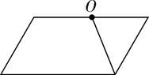

# Mathematics (Grade 5)

**ID**: 65b9002d
**难度**: medium
**题型**: multiple_choice

## 题目
下图中，点O是平行四边形一条边上的中点，则梯形的面积是三角形面积的(  )倍。

A．2
B．3
C．4

## 解答

**答案**: B

1. Step1:设平行四边形的底为2a，高为h。因为点O是平行四边形一条边上的中点，所以三角形的底为a，高为h，根据三角形面积公式S = 1/2×底×高，可得三角形面积S1 = 1/2×a×h。
2. Step2:梯形的上底为a，下底为2a，高为h，根据梯形面积公式S=(上底 + 下底)×高÷2，可得梯形面积S2=(a + 2a)×h÷2 = 3/2×a×h。
3. Step3:求梯形面积是三角形面积的几倍，用梯形面积除以三角形面积，即S2÷S1=(3/2×a×h)÷(1/2×a×h)=3。所以梯形的面积是三角形面积的3倍，答案选B。

## 知识点

**知识点**:
  - 小学数学;图形与几何;平面图形;平行四边形;平行四边形的面积;梯形的特征及分类;梯形的面积;三角形;三角形的面积

---
