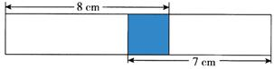

# Mathematics (Grade 5)

**ID**: 67c528e8
**难度**: medium
**题型**: multiple_choice

## 题目
如下图，涂色部分是正方形，最大长方形的周长是(   )厘米。

A．15
B．30
C．24
D．36

## 解答

**答案**: B

1. Step1:设正方形的边长为a厘米
2. Step2:由图可知，长方形的长为8 + 7 - a厘米，宽为a厘米
3. Step3:根据长方形周长公式C=(长+宽)×2，可得长方形周长为[(8 + 7 - a + a)×2]厘米
4. Step4:化简(8 + 7 - a + a)×2，因为 - a + a = 0，所以(8 + 7 - a + a)×2=(8 + 7)×2
5. Step5:计算(8 + 7)×2 = 15×2 = 30厘米，所以最大长方形的周长是30厘米

## 知识点

**知识点**:
  - 小学数学;数与代数;式与方程;列方程解含两个未知数的问题

---
