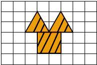

# Mathematics (Grade 5)

**ID**: 6dfabe7f
**难度**: medium
**题型**: multiple_choice

## 题目
方格纸上的图形面积是(  )平方厘米．(每个小方格的边长为1厘米)

A．6
B．8
C．10
D．12

## 解答

**答案**: B

1. Step1:明确每个小方格边长为1厘米，根据正方形面积公式S=a²（a为边长），可知每个小方格面积为1×1 = 1平方厘米
2. Step2:观察图形，由解析2可知图形面积由两个三角形的面积和一个正方形的面积组成
3. Step3:计算三角形面积，三角形底为2厘米，高为2厘米，根据三角形面积公式S = $rac{1}{2}$ah（a为底，h为高），一个三角形面积为$rac{1}{2}$×2×2 = 2平方厘米，那么两个三角形面积为2×2 = 4平方厘米
4. Step4:计算正方形面积，正方形边长为2厘米，根据正方形面积公式可得其面积为2×2 = 4平方厘米
5. Step5:计算图形总面积，将两个三角形面积与正方形面积相加，即4 + 4 = 8平方厘米，所以答案选B

## 知识点

**知识点**:
  - 组合图形的面积．

---
