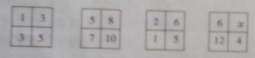

# Mathematics (Grade 5)

**ID**: 718450b7
**难度**: medium
**题型**: multiple_choice

## 题目
在下列2×2的方格中找出规律，则x的应是（  ）．

 A．10
 B．-2
 C．2
 D．0

## 解答

**答案**: B

1. Step1:观察所给的2×2方格，发现解析2中提到的规律，即四个方格中，对角线方向的两个方格的数字之和相等
2. Step2:对于第一个方格，1+5=3+3=6，验证了该规律
3. Step3:对于第二个方格，5+10=7+8=15，再次验证该规律
4. Step4:对于第三个方格，2+5=1+6=7，又一次验证该规律
5. Step5:对于第四个方格，根据上述规律可得3+7=12+x
6. Step6:求解方程3+7=12+x，即10 = 12 + x，移项可得x = 10 - 12
7. Step7:计算得出x = -2，所以答案选B

## 知识点

**知识点**:
  - --

---
