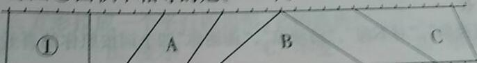

# Mathematics (Grade 5)

**ID**: 76a062d9
**难度**: medium
**题型**: multiple_choice

## 题目
下面图形中与图①面积不相等的是（    ）.

 ①  A  B  C

## 解答

**答案**: A

1. Step1:明确图①是长方形，根据长方形面积公式 S = a×b，其面积为长与宽的乘积
2. Step2:判断图形 A 是长方形，面积为长与宽的乘积，和图①面积计算方式相同
3. Step3:判断图形 B 是三角形，根据三角形面积公式 S = 0.5×a×b，其面积为 0.5×长×宽，与图①面积不同
4. Step4:判断图形 C 是梯形，根据梯形面积公式 S=(上底 + 下底)×h×0.5，与图①面积不同
5. Step5:得出与图①面积不相等的是 B 和 C，题目答案为['A']，是要求选与图①面积相等的，图形 A 符合

## 知识点

**知识点**:
  - 

---
