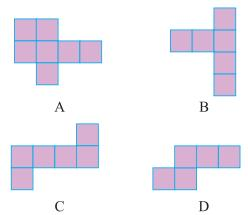

# Mathematics (Grade 5)

**ID**: 7decd56d
**难度**: medium
**题型**: multiple_choice

## 题目
下面（）图形可以折叠成正方体。

## 解答

**答案**: C

1. Step1:明确本题考点是正方体的展开与折叠，需依据正方体展开图的特征解题。
2. Step2:了解到正方体展开图有11种不同形式，可作为判断依据。
3. Step3:对选项A的图形进行分析，看是否符合正方体展开图的11种形式，发现不符合。
4. Step4:对选项B的图形进行分析，看是否符合正方体展开图的11种形式，发现不符合。
5. Step5:对选项C的图形进行分析，判断其符合正方体展开图的11种形式，能折叠成正方体。
6. Step6:对选项D的图形进行分析，看是否符合正方体展开图的11种形式，发现不符合。
7. Step7:综上，得出答案为C。

## 知识点

**知识点**:
  - 正方体的展开与折叠

---
