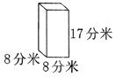

# Mathematics (Grade 5)

**ID**: 824293c7
**难度**: medium
**题型**: multiple_choice

## 题目
计算下图中长方体的表面积，算式错误的是（  ）。

$\begin{description}
\item A．8×8×17\item B．8×17×4＋8×8×2\item C．（8×17＋8×17＋8×8）×2
\end{description}$

## 解答

**答案**: A

1. Step1:明确长方体表面积公式为(长×宽 + 长×高 + 宽×高)×2。
2. Step2:分析该长方体，长、宽均为8分米，高为17分米。
3. Step3:根据公式计算其表面积为(8×17 + 8×17 + 8×8)×2，C选项正确。
4. Step4:将(8×17 + 8×17 + 8×8)×2展开得到8×17×2 + 8×17×2 + 8×8×2 = 8×17×4 + 8×8×2，B选项正确。
5. Step5:8×8×17不符合长方体表面积公式，A选项错误。

## 知识点

**知识点**:
  - 小学数学;图形与几何

---
