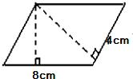

# Mathematics (Grade 5)

**ID**: 944936cf
**难度**: medium
**题型**: multiple_choice

## 题目
如图．一个平行四边形相邻两条边长度分别是4厘米和8厘米，其中一条底边上的高是6厘米，这个平行四边形的面积是（  ）
A．24平方厘米
B．48平方厘米
C．32平方厘米

## 解答

**答案**: A

1. Step1:分析平行四边形底和高的对应关系，由于高是两条平行线内最短的线段，当底为8厘米时，高不可能为6厘米，所以确定底为4厘米，高为6厘米。
2. Step2:根据平行四边形面积公式面积=底×高，将底4厘米和高6厘米代入公式，即4×6。
3. Step3:计算4×6的结果为24平方厘米，得到平行四边形的面积。

## 知识点

**知识点**:
  - 平行四边形的面积．

---
