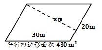

# Mathematics (Grade 5)

**ID**: 9aa97a28
**难度**: medium
**题型**: multiple_choice

## 题目
图中x=（  ）
A．16
B．24
C．18

## 解答

**答案**: B

1. Step1:明确平行四边形面积公式为面积 = 底×高
2. Step2:已知面积是480平方米，底为20米
3. Step3:根据高 = 面积÷底，可得x = 480÷20
4. Step4:计算480÷20 = 24米，所以x = 24米，答案选B

## 知识点

**知识点**:
  - 平行四边形的面积．

---
