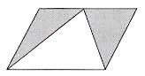

# Mathematics (Grade 5)

**ID**: 9aed66de
**难度**: medium
**题型**: multiple_choice

## 题目
如图，平行四边形的面积是4.8cm$^{2}$ ，阴影部分的面积（   ）2.4cm$^{2}$。

A．大于
B．小于
C．等于

## 解答

**答案**: C

1. Step1:观察图形可知，空白三角形与平行四边形等底等高。
2. Step2:根据三角形面积公式S = 1/2ah（a为底，h为高），平行四边形面积公式S = ah，可得等底等高的三角形面积是平行四边形面积的一半。
3. Step3:已知平行四边形面积是4.8cm²，那么空白三角形面积为4.8÷2 = 2.4cm²。
4. Step4:因为平行四边形面积由阴影部分面积和空白三角形面积组成，所以阴影部分面积 = 平行四边形面积 - 空白三角形面积，即4.8 - 2.4 = 2.4cm²。
5. Step5:得出阴影部分的面积等于2.4cm²，答案选C。

## 知识点

**知识点**:
  - 小学数学;图形与几何;平面图形;平行四边形;平行四边形的面积;三角形;三角形的面积

---
