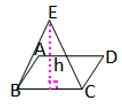

# Mathematics (Grade 5)

**ID**: 9d3bd90a
**难度**: medium
**题型**: multiple_choice

## 题目
如下图，三角形BEC的面积和平行四边形的ABCD的面积都是64cm²，BC
的长是16 cm，三角形BEC的高是（    ）。

$\begin{description}
\item A．4\item B．8\item C．10\item D．16
\end{description}$

## 解答

**答案**: B

1. Step1:已知三角形BEC的面积公式为S = 1/2×底×高，这里底为BC，面积S = 64cm²，BC = 16cm
2. Step2:设三角形BEC的高为h，根据面积公式可列出方程64 = 1/2×16×h
3. Step3:化简方程1/2×16×h = 64，得到8h = 64
4. Step4:求解方程8h = 64，两边同时除以8，得出h = 8cm，所以答案选B

## 知识点

**知识点**:
  - 

---
