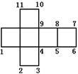

# Mathematics (Grade 5)

**ID**: a0c79df2
**难度**: medium
**题型**: multiple_choice

## 题目
如下图，是一个正方体展开图，当把它重新折叠成一个正方体时，3与（   ）重合。

A．4
B．5
C．6
D．9

## 解答

**答案**: B

1. Step1:想象将正方体展开图重新折叠成正方体的过程。
2. Step2:观察发现数字3所在的面在折叠后会与数字5所在的面重合。

## 知识点

**知识点**:
  - 小学数学;图形与几何;立体图形;长方体和正方体;正方体的展开图

---
