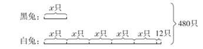

# Mathematics (Grade 5)

**ID**: a3cf743b
**难度**: medium
**题型**: multiple_choice

## 题目
看下图，列的方程正确的是(  )。

$\begin{description}
\item A．5\textit{x}＋12＝480\item B．5\textit{x}－12＝480\item C．6\textit{x}＋12＝480
\end{description}$

## 解答

**答案**: C

1. Step1:由图可知黑兔有\(x\)只，白兔有\(5x + 12\)只
2. Step2:又知黑兔和白兔一共有\(480\)只，所以可列方程\(x + (5x + 12) = 480\)
3. Step3:对\(x + (5x + 12) = 480\)去括号化简，得到\(x + 5x + 12 = 480\)，即\(6x + 12 = 480\)，故答案选C

## 知识点

**知识点**:
  - 小学数学;数与代数;式与方程;方程与等式的关系

---
