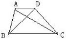

# Mathematics (Grade 5)

**ID**: acde20dc
**难度**: medium
**题型**: multiple_choice

## 题目
如图，梯形ABCD 中共有8 个三角形，其中面积相等的三角形有( )．

$\begin{description}
\item A．1 对\item B．2 对\item C．3 对\item D．4 对
\end{description}$

## 解答

**答案**: C

1. Step1:因为梯形 ABCD 中，△ABC 和△DBC 有相同的底 BC，且这两个三角形的高都等于梯形的高，根据三角形面积公式 S = 1/2×底×高，所以△ABC 和△DBC 面积相等。
2. Step2:同理，△ABD 和△ACD 有相同的底 AD，且它们的高也都等于梯形的高，根据三角形面积公式可得△ABD 和△ACD 面积相等。
3. Step3:设 AC 与 BD 相交于点 O，因为△ABC 和△DBC 面积相等，同时减去△BOC 的面积，那么△ABO 和△DCO 面积也相等。
4. Step4:综上，面积相等的三角形有△ABC 和△DBC，△ABD 和△ACD，△ABO 和△DCO，共 3 对，所以答案选 C。

## 知识点

**知识点**:
  - 小学数学;图形与几何;平面图形;三角形;三角形的面积

---
