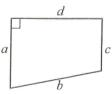

# Mathematics (Grade 5)

**ID**: b22872a7
**难度**: medium
**题型**: multiple_choice

## 题目
下面梯形的上底和下底分别是(  )
A．a和b
B．b和d
C．b和c
D．a和c

## 解答

**答案**: D

1. Step1:明确梯形的定义为只有一组对边平行的四边形
2. Step2:根据梯形定义，确定互相平行的一组对边是梯形的上底和下底
3. Step3:观察图形，判断出a和c这组对边互相平行
4. Step4:得出a和c分别是梯形的上底和下底，所以答案选D

## 知识点

**知识点**:
  - 梯形的特征及分类;用字母表示数．

---
