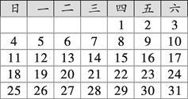

# Mathematics (Grade 5)

**ID**: b6629abc
**难度**: medium
**题型**: multiple_choice

## 题目
暑假期间，芳芳和明明去图书馆，芳芳每4天去一次，明明每5天去一次，8月2日两人在图书馆相遇，（   ）他们又再次相遇．

A．8月18日
B．8月20日
C．8月22日
D．8月24日

## 解答

**答案**: C

1. Step1:先求出4和5的最小公倍数，因为4和5互质，所以它们的最小公倍数为4×5 = 20。
2. Step2:8月2日两人相遇，再过20天会再次相遇，2 + 20 = 22。
3. Step3:所以再次相遇的日期是8月22日，答案选C。

## 知识点

**知识点**:
  - 小学数学;数与代数;应用题;简单应用题;公因数、公倍数应用题

---
