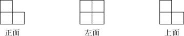

# Mathematics (Grade 5)

**ID**: b7ec2ccc
**难度**: medium
**题型**: multiple_choice

## 题目
有一个由正方体积木搭起的图形从三个不同的方向看的图形如下，那么这个图形至少由(  )个小正方体搭成。

A．3
B．4
C．5
D．6

## 解答

**答案**: C

1. Step1:从上面看的图形可知，底层至少有4个小正方体，分布为前排2个，后排2个。
2. Step2:从正面看的图形可知，除了底层的小正方体，上面至少有1个小正方体，且在后排左边位置。
3. Step3:从左面看的图形也符合上述小正方体的分布情况。
4. Step4:将底层和上层的小正方体数量相加，4 + 1 = 5，所以这个图形至少由5个小正方体搭成。

## 知识点

**知识点**:
  - 

---
