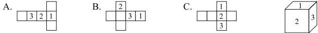

# Mathematics (Grade 5)

**ID**: beecda01
**难度**: medium
**题型**: multiple_choice

## 题目
下面（）是已知正方体的展开图。

## 解答

**答案**: B

1. Step1:明确本题考查正方体展开图的认识，解题关键是明确正方体展开图相对面相隔的特征
2. Step2:分析A选项，发现其中1与3相对，与已知正方体不符，所以A选项错误
3. Step3:分析B选项，发现其图形符合已知正方体展开图的特征
4. Step4:由于其他选项错误且B选项符合，所以答案是B

## 知识点

**知识点**:
  - 长、正方体的展开与折叠

---
