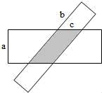

# Mathematics (Grade 5)

**ID**: bf906d64
**难度**: medium
**题型**: multiple_choice

## 题目
如下图，两张长度相等的长方形重叠在一起，阴影部分的面积是（  ）

$\begin{description}
\item A．ab\item B．bc\item C．ac\item D．c^{2}
\end{description}$

## 解答

**答案**: C

1. Step1:观察图形可知，阴影部分是一个长方形
2. Step2:该长方形的长为a，宽为c
3. Step3:根据长方形面积公式S = 长×宽，可得阴影部分面积为a×c = ac
4. Step4:所以答案选C

## 知识点

**知识点**:
  - 小学数学;数与代数;式与方程;用字母表示数;图形与几何;平面图形;平行四边形;平行四边形的面积

---
