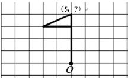

# Mathematics (Grade 5)

**ID**: c0157dcd
**难度**: medium
**题型**: multiple_choice

## 题目
如图，小旗的顶点用数对表示为（5，7），现在将小旗绕点O，顺时针方向旋转90°，现在小旗的顶点可以用数对（   ）表示。

$\begin{description}
\item A．（7，5）\item B．（10，3）\item C．（9，3）\item D．（1，3）
\end{description}$

## 解答

**答案**: C

1. Step1:明确旋转中心为点O，旋转方向为顺时针，旋转角度为90°。
2. Step2:已知原小旗顶点数对为（5，7），以点O为中心顺时针旋转90°后，观察图形中顶点位置的变化。
3. Step3:通过对图形旋转的分析和数对的规则，得到旋转后顶点对应的列数为9，行数为3，所以旋转后小旗顶点用数对（9，3）表示，答案选C。

## 知识点

**知识点**:
  - 小学数学;图形与几何;图形与变换;作旋转后的图形;位置与方向;数对与位置

---
