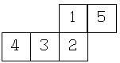

# Mathematics (Grade 5)

**ID**: c113b6ba
**难度**: medium
**题型**: multiple_choice

## 题目

(2009•高邮市模拟)将如图折成一个正方体，这时与2号面相对的面是(  )
A．5号
B．4号
C．6号

## 解答

**答案**: B

1. Step1:明确题目要求是找出折成正方体后与2号面相对的面
2. Step2:根据正方体展开图的特点，对给定图形进行折叠想象
3. Step3:通过折叠可知与2号面相对的面是4号
4. Step4:查看选项，4号对应的选项是B

## 知识点

**知识点**:
  - 正方体的展开图．

---
