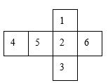

# Mathematics (Grade 5)

**ID**: c897b5c2
**难度**: medium
**题型**: multiple_choice

## 题目
下图是正方体的展开图，与1号面相对的面是（     ）号面。

$\begin{description}
\item A．1\item B．2\item C．3\item D．4
\end{description}$

## 解答

**答案**: C

1. Step1:根据正方体展开图的特征，相对的面在展开图中是间隔出现的。
2. Step2:观察此展开图，1号面与3号面是间隔一个面的关系。
3. Step3:所以与1号面相对的面是3号面，答案选C。

## 知识点

**知识点**:
  - 

---
