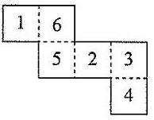

# Mathematics (Grade 5)

**ID**: d21474f4
**难度**: medium
**题型**: multiple_choice

## 题目
下面是一个正方体的展开图，与1号面相对应的是（   ）号面

 A．2
 B．3
 C．4

## 解答

**答案**: A

1. Step1:明确题目是要找出正方体展开图中1号面的对应面
2. Step2:依据正方体表面展开图找对应面的方法来分析
3. Step3:得出1号面对应2号面
4. Step4:确定答案为A

## 知识点

**知识点**:
  - 第四单元测试卷;

---
