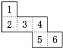

# Mathematics (Grade 5)

**ID**: e23bbbcc
**难度**: medium
**题型**: multiple_choice

## 题目
把如图的纸片沿虚线折叠起来可以成为一个正方体．这个正方体上与数字“6”所在面相对的面上的数字是(    )．

## 解答

**答案**: 3

1. Step1:观察正方体展开图，判断其类型为'132'型
2. Step2:确定以数字4所在的面为底面
3. Step3:根据展开图特征，得出数字6所在面为正方体右侧面
4. Step4:根据展开图特征，得出数字3所在面为正方体左侧面
5. Step5:因为正方体相对面的关系，得出与数字6所在面相对的面上的数字是3

## 知识点

**知识点**:
  - 正方体的展开图．

---
