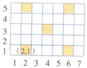

# Mathematics (Grade 5)

**ID**: e4cee27c
**难度**: medium
**题型**: multiple_choice

## 题目
如图为小妍家客厅墙上贴的墙砖示意图，中间的一块墙砖用数对表示是（  ）。

A．（3，4）
B．（2，5）
C．（4，3）
D．（5，2）

## 解答

**答案**: C

1. Step1:明确数对的概念，数对是一个表示位置的概念，前一个数字表示列，后一个数字表示行
2. Step2:观察图形，中间那块墙砖所在的列是从左往右数第4列
3. Step3:中间那块墙砖所在的行是从下往上数第3行
4. Step4:所以中间的一块墙砖用数对表示是（4，3），答案选C

## 知识点

**知识点**:
  - 小学数学;图形与几何;位置与方向;数对与位置

---
