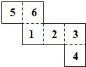

# Mathematics (Grade 5)

**ID**: e52b6af4
**难度**: medium
**题型**: multiple_choice

## 题目
如图是一个正方体的展开图，与6号相对的面是（  ）面．

$\begin{description}
\item A．2\item B．4\item C．5\item D．1\item E．3
\end{description}$

## 解答

**答案**: B

1. Step1:明确这是一个关于正方体展开图中找相对面的问题
2. Step2:根据正方体展开图的特征，相对的面在展开图中是间隔一个正方形的
3. Step3:观察展开图，6号面与2号面、5号面相邻，与1号面、3号面也相邻
4. Step4:所以与6号面相对的面只能是4号面

## 知识点

**知识点**:
  - 小学数学;图形与几何;立体图形;长方体和正方体;正方体的展开图

---
