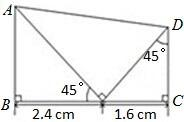

# Mathematics (Grade 5)

**ID**: eee11bd7
**难度**: medium
**题型**: multiple_choice

## 题目
如图，四边形$\textit{ABCD}$是一个梯形，由三个直角三角形拼成，它的面积是（    ）。

$\begin{description}
\item A．1.92 cm^{2}\item B．16 cm^{2}\item C．4 cm^{2}\item D．8 cm^{2}
\end{description}$

## 解答

**答案**: D

1. Step1:根据图中两个45°的直角三角形，可知梯形的高等于两个直角三角形的直角边之和，即2.4 + 1.6 = 4cm。
2. Step2:同时，这两个45°的直角三角形的直角边分别为梯形的上底和下底，所以梯形上底与下底的和也为2.4 + 1.6 = 4cm。
3. Step3:根据梯形面积公式S=(a + b)h÷2（其中a、b为上底和下底，h为高），将上底与下底的和4cm以及高4cm代入公式，可得S = 4×4÷2 = 8cm²。

## 知识点

**知识点**:
  - 小学数学;图形与几何

---
