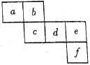

# Mathematics (Grade 5)

**ID**: f2684331
**难度**: medium
**题型**: multiple_choice

## 题目
下图是一个正方体的展开图，和b面相对的面是（   ）面。

A．a
B．d
C．e
D．f

## 解答

**答案**: D

1. Step1:根据正方体展开图的特征，相对的面在展开图中是间隔出现的。
2. Step2:观察展开图，b面与d面、c面相邻，与a面同行且相邻。
3. Step3:逐一分析选项，A选项a面与b面相邻；B选项d面与b面相邻；C选项e面与b面没有直接关系且不符合相对面特征；D选项f面与b面间隔出现，符合正方体展开图相对面的特征。

## 知识点

**知识点**:
  - 小学数学;图形与几何;立体图形;长方体和正方体;正方体的展开图

---
